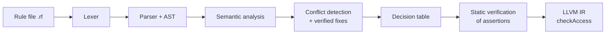

# RuleForge

**A verifying compiler for English-like access-control rules.**

RuleForge takes access rules written in plain, English-like sentences, checks them for mistakes and conflicts, proves the security requirements you state, and compiles the verified policy into an LLVM IR function:

```c
checkAccess(role, resource, action)  ->  { allowed, deciding_rule }
```

Everything is checked **at compile time**, before any code exists. A policy with a broken security requirement does not compile.

> BCSE307P – Compiler Design Lab project, VIT Vellore.

---

## Why

Cloud access policies (AWS IAM, Azure RBAC, ...) are written in complex machine formats. People make mistakes, and the worst ones are conflicts that nobody can see by reading the rules, for example a Deny that a role silently inherits from its parent. AI translators accept plain English but can produce different results for the same input.

RuleForge treats access rules as a small programming language and applies real compiler techniques to it, so the result is **deterministic, verified and explainable**.

## Features

| Feature | What it does |
| --- | --- |
| **Hidden conflict detection** | Finds Allow/Deny clashes, including ones that only exist through role inheritance, and names the exact rules involved |
| **Verified fix suggestions** | For every conflict, proposes two fixes written as real rules (keep access denied, or grant it). Each fix is re-analysed by the compiler before it is shown, with the exact access decisions it would change |
| **Compile-time security assertions** | `assert Intern cannot write Salary_*;` is proved over every case. A violation stops compilation and prints a counterexample with the rule and inheritance path that causes it |
| **Explainable decisions** | `--explain` and `--who-can` show the deciding rule, the inheritance path, and the rules it overrode |
| **LLVM code generation** | The verified policy becomes a constant decision table and a `checkAccess` function in LLVM IR, verified by LLVM's own tools |
| **Clear diagnostics** | Lexical, syntax and semantic errors with `line:column`, plus "did you mean ...?" suggestions for typos |

## Quick example

`policy.rf`:

```
role Employee;
role Manager : Employee;          # Manager inherits Employee's rules

resource Salary_Records;
resource Salary_History;

action read;

Deny Employee to read Salary_Records;
Allow Manager to read Salary_*;
```

No single line looks wrong, but RuleForge finds the problem and suggests verified fixes:

```
Conflicts
  policy.rf:10:1: hidden conflict: (Manager, Salary_Records, read)
      Allow #2 (line 10) written for Manager
      Deny  #1 (line 9) inherited from Employee

Suggested fixes (each one re-checked by the compiler)
  Conflict group 1: Allow #2 vs Deny #1 on 'read' for (Manager, Salary_Records)
    Fix A - keep access denied (drop the part of the Allow that never takes effect):
      change rule #2 (line 10) to:  Allow Manager to read Salary_History;
      check: conflict removed, no access decision changes
    Fix B - grant access (narrow the Deny):
      delete rule #1 (line 9)
      check: conflict removed, 1 access decision(s) change:
        Manager read Salary_Records: DENY #1 -> ALLOW #2
```

Ask why a decision was made:

```
> ruleforge --explain Manager read Salary_Records policy.rf

Manager read Salary_Records -> DENIED
  decided by rule #1 (line 9): Deny Employee to read Salary_Records;
    inherited via Manager -> Employee
  overridden (deny overrides allow): rule #2 (line 10): Allow Manager to read Salary_*;
    written for Manager
```

State a security requirement, and the compiler proves it or refuses to build:

```
assert Intern cannot write Salary_*;
```

```
FAILED  A1 (line 14): Intern cannot write Salary_*   [1 of 1 case(s) violate it]
error: assertion A1 failed: Intern cannot write Salary_*
  counterexample:
    Intern write Salary_Records -> ALLOWED
      decided by rule #1 (line 12): Allow Employee to write *;
        inherited via Intern -> Employee

1 assertion(s) failed - no code generated
```

## The language

```
program      -> decl* (rule | assertion)*
decl         -> "role" IDENT (":" IDENT)? ";"
              | "resource" IDENT ";"
              | "action" IDENT ";"
rule         -> EFFECT IDENT "to" IDENT resource_ref ";"
assertion    -> "assert" subject ("can" | "cannot") IDENT resource_ref ";"
subject      -> IDENT | "every" "role" | "no" "role"
resource_ref -> "*" | IDENT | IDENT "*"

EFFECT       -> allow | permit | grant  |  deny | forbid | block
```

* `role Manager : Employee;` makes Manager inherit every rule written for Employee.
* `Salary_*` matches every resource starting with `Salary_`; `*` matches every resource.
* **Deny overrides Allow.** If no rule applies, the answer is **deny**.
* Keywords are case-insensitive; names are case-sensitive. `#` starts a comment.

## Compiler pipeline



| Step | Module | What it does |
| --- | --- | --- |
| 1 | Grammar | Fixed English-like rule language (see above) |
| 2 | `lexer.c` | Text to tokens with line/column; normalizes synonyms |
| 3 | `parser.c`, `ast.c` | Recursive descent parser; AST with LLVM-style RTTI in C (`ISA` / `CAST` / `DYN_CAST`) |
| 4 | `sema.c` | Symbol table, duplicate / undeclared / inheritance-cycle checks, typo hints, wildcard expansion, role ancestor lists |
| 5 | `conflict.c`, `fix.c` | Direct and hidden conflicts; two re-checked fixes per conflict |
| 6 | `table.c` | Final decision for every (role, resource, action), stored as one flat array |
| 7 | `verify.c` | Proves each assertion over every case it covers; a violation is a compile error |
| 8 | `codegen.c` | LLVM IR: `%Decision = { i1, i32 }`, a constant global table, `checkAccess`, `checkAccessPacked` |
| – | `explain.c` | Deciding rule + inheritance path for any decision (used by `--explain`, `--who-can`, counterexamples) |

Because the set of roles, resources and actions is finite, RuleForge checks **every** case. Its conflict detection and assertion proofs are complete, not approximate.

## Build

Requires **gcc** (MinGW on Windows). **clang / LLVM** is only needed to run the compiled-code tests.

```powershell
# Windows PowerShell
gcc -std=c11 -Wall -o ruleforge.exe (Get-ChildItem src -Filter *.c).FullName
```

```bash
# Linux / macOS
gcc -std=c11 -Wall -o ruleforge src/*.c
```

## Usage

```
ruleforge [--steps] [--tokens] [-o out.ll] [--header out.h] <file.rf>
ruleforge --explain <role> <action> <resource> <file.rf>
ruleforge --who-can <action> <resource> <file.rf>
```

| Option | Meaning |
| --- | --- |
| `--steps` | Print a heading and the output of each compiler step |
| `--tokens` | Also print the lexer's token list |
| `-o file.ll` | Where to write the LLVM IR (default: next to the input) |
| `--header file.h` | Also write a C header with name IDs and the expected decisions |
| `--explain R A X` | Explain why role `R` is allowed or denied action `A` on resource `X` |
| `--who-can A X` | List every role's answer for action `A` on resource `X`, with the reason |

Examples:

```powershell
.\ruleforge.exe --steps tests\hidden_conflict.rf
.\ruleforge.exe tests\assertions_fail.rf
.\ruleforge.exe --who-can read Salary_Records tests\step4_ok.rf
```

### Calling the compiled policy from C

```powershell
.\ruleforge.exe policy.rf -o policy.ll --header policy.h
clang -c policy.ll -o policy.o --target=x86_64-w64-windows-gnu
```

```c
#include "policy.h"
int r = checkAccessPacked(ROLE_Manager, RESOURCE_Salary_Records, ACTION_read);
int allowed = r & 1;     /* 1 = allow, 0 = deny        */
int rule    = r >> 1;    /* rule that decided, 0 = none */
```

## Testing

```powershell
powershell -ExecutionPolicy Bypass -File .\run_tests.ps1
```

* **Part A**: runs all 14 files in `tests/` and compares exit code, output and error messages with `tests/expected/`.
* **Part B**: compiles each generated `.ll` with clang, links it with `tests/test_access.c`, and checks that the compiled `checkAccess` returns the correct decision for every combination and denies every out-of-range request. It is skipped if clang is not installed.

| Test file | Checks |
| --- | --- |
| `clean.rf` | Valid rules, no conflicts |
| `direct_conflict.rf` | Allow and Deny for the same role |
| `hidden_conflict.rf` | Conflict that only appears through inheritance |
| `step4_ok.rf` | 3-level inheritance, wildcards, a wildcard that matches nothing |
| `synonyms.rf` | permit / grant / forbid / block, case-insensitive keywords |
| `wildcards.rf` | `*` and prefix wildcards, conflicts created by wildcards |
| `empty.rf` | Empty policy: everything is denied |
| `assertions_ok.rf` | Four security assertions, all proved |
| `assertions_fail.rf` | Assertion violated through inheritance; no code generated |
| `query_explain.rf` | `--explain` output |
| `query_who_can.rf` | `--who-can` output |
| `lex_error.rf` | Invalid character |
| `syntax_error.rf` | Missing `;` |
| `step4_errors.rf` | Duplicates, undeclared names, inheritance cycle, typo suggestions |

## Project structure

```
ruleforge/
├── src/
│   ├── main.c                   driver: runs the steps in order
│   ├── lexer.c / lexer.h        step 2
│   ├── parser.c / parser.h      step 3
│   ├── ast.c / ast.h            step 3 (AST + RTTI macros)
│   ├── sema.c / sema.h          step 4
│   ├── conflict.c / conflict.h  step 5
│   ├── fix.c / fix.h            step 5 (verified fixes)
│   ├── table.c / table.h        step 6
│   ├── verify.c / verify.h      step 7
│   ├── codegen.c / codegen.h    step 8
│   └── explain.c / explain.h    explanations
├── tests/
│   ├── *.rf                     test policies
│   ├── expected/                expected output for each test
│   └── test_access.c            calls the compiled checkAccess
├── run_tests.ps1                one-command test suite
└── README.md
```

## Team

* Aishwarya Vaidyanathan (24BCE2683)
* Haripriya Padamati (24BCE2427)

Guide: Dr. K. Nithya, School of Computer Science and Engineering, VIT Vellore.